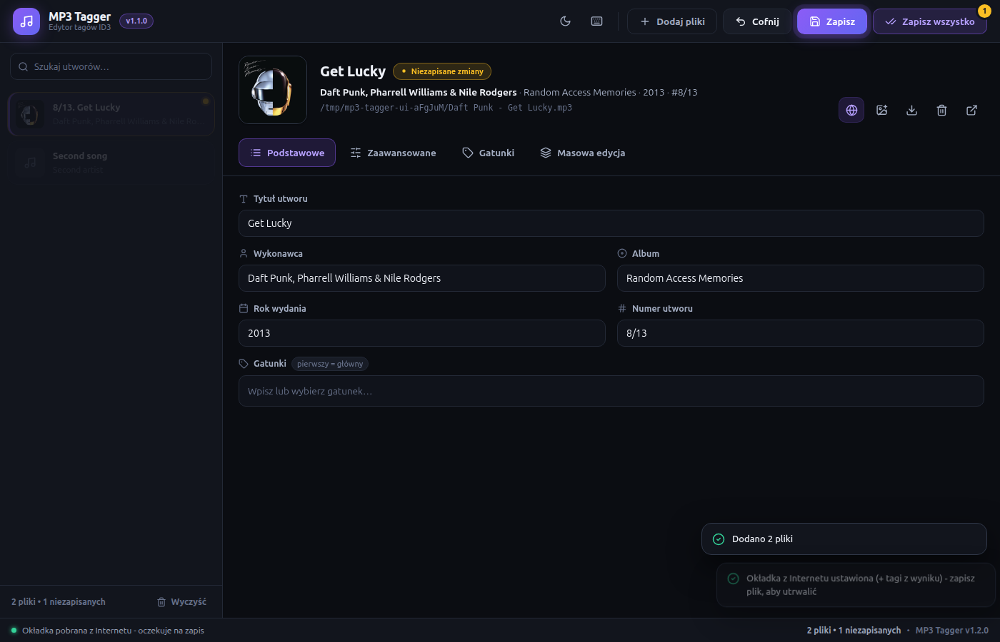

# MP3 Tagger

Aplikacja do edycji tagów ID3 w plikach MP3, z polskim interfejsem. Pozwala porządkować metadane i okładki pojedynczych utworów oraz całych kolekcji.



## Funkcje

- Edycja tytułu, wykonawcy, albumu, roku, numeru utworu, gatunków i dodatkowych tagów, w tym tekstu piosenki.
- Masowa edycja tagów wielu plików.
- Dodawanie, podgląd, eksport i usuwanie okładek.
- Wyszukiwanie okładek i pobieranie metadanych z iTunes oraz Deezer.
- Filtrowanie listy utworów, przeciąganie plików do okna i skróty klawiszowe.
- Jasny i ciemny motyw oraz ostrzeżenia o niezapisanych zmianach.

Edycja działa offline; połączenie z Internetem jest potrzebne do wyszukiwania okładek.

## Uruchomienie z repozytorium

Wymagane: Git, Node.js 22.12 lub nowszy oraz npm.

```bash
git clone https://github.com/PaffcioStudio/mp3-tagger.git
cd mp3-tagger
npm install
npm start
```

## Budowanie i instalacja

Po instalacji zależności uruchom polecenie dla wybranego systemu:

```bash
npm run build:linux   # AppImage, DEB, Snap, tar.gz
npm run build:win     # Instalator EXE i wersja przenośna
npm run build:mac     # DMG i ZIP
```

Gotowe pliki pojawią się w katalogu `dist/`. Wersję macOS buduj na macOS.

Na Debianie, Ubuntu i systemach pochodnych zainstaluj pakiet DEB:

```bash
sudo apt install ./dist/mp3-tagger_*.deb
```

Po instalacji uruchom aplikację z menu systemu. Na innych dystrybucjach Linuksa możesz nadać plikowi AppImage uprawnienie do uruchamiania i otworzyć go bez instalacji. Na Windows uruchom instalator `*-setup.exe`, a na macOS otwórz DMG i przeciągnij aplikację do folderu Aplikacje.

## Licencja

[MIT](LICENSE) — Paweł Potrykus (Paffcio).
